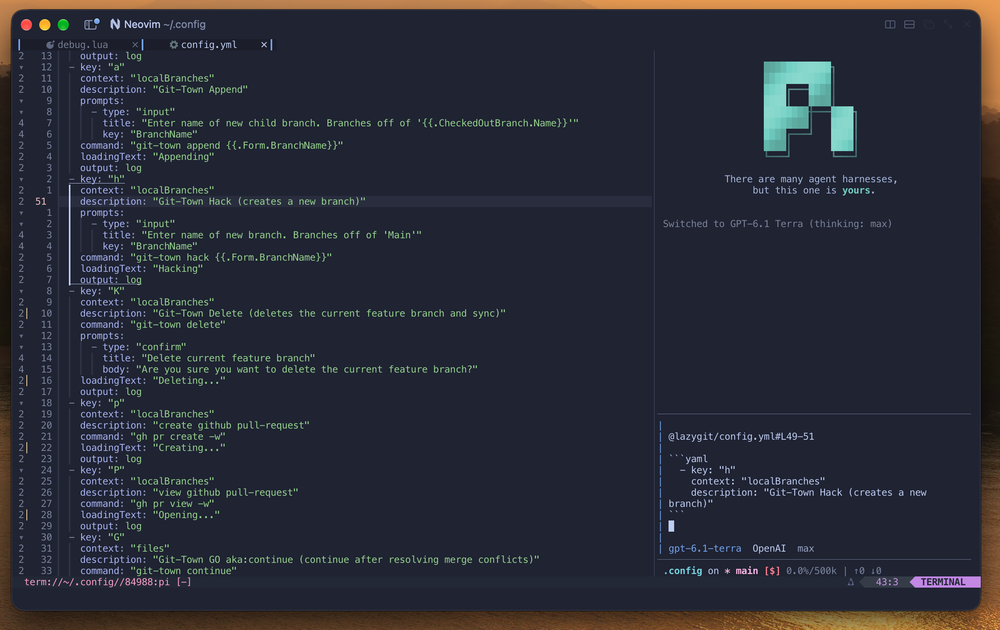
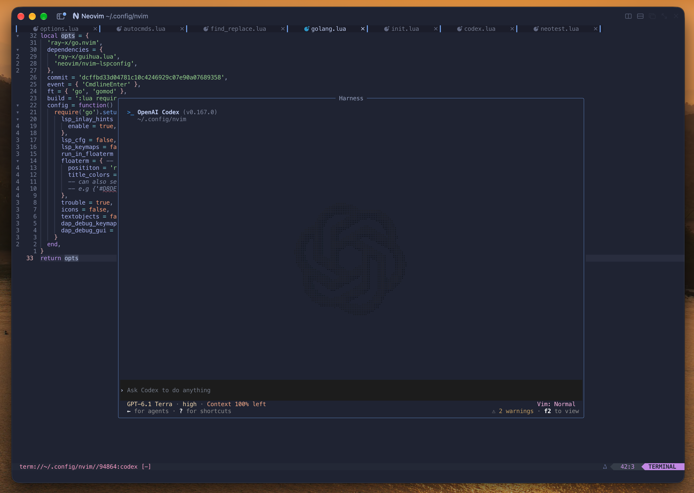

<p align="center">
    
</p>

<div align="center" >

# CODEX.NVIM

<i>Bringing Coding Harness' to Neovim </i>




| **Primary home:** [Codeberg](https://codeberg.org/yaadata/codex.nvim) | Mirrored on [GitHub](https://github.com/yaadata/codex.nvim) |
| :-------------------------------------------------------------------: | :---------------------------------------------------------: |

</div>

## ✨ Features

- 🧩 Compose workflows with session, input, prompt-builder, and log APIs.
- 🔌 Use `codex.builtin` for agent-specific mentions, slash commands, skills,
  and resume flows.
- 🌱 Use the native terminal provider or `snacks`, configure profiles, and
  set up global or terminal-local keymaps.
- 📚 Use `:help codex.nvim` for configuration, Lua API, and keymap examples.

## Requirements

- Neovim >= 0.12.0
- `codex` available on your `PATH` (or configure `launch.cmd`)

> [!CAUTION]
> You are reading the `main` branch README. Install details may differ from
> tagged releases. The current v2 beta release tag is
> [`2.0.0-beta.4`](https://codeberg.org/yaadata/codex.nvim/src/tag/v2.0.0-beta.4).
> For version-accurate instructions, read the README for your target tag from
> [Codeberg releases](https://codeberg.org/yaadata/codex.nvim/releases).

## Install

```lua
{
  url = "https://codeberg.org/yaadata/codex.nvim.git",
  version = "2.0.0-beta.4",
  lazy = false,
  opts = {},
  config = function(_, opts)
    require("codex").setup(opts)
  end,
}
```

This configuration supports `:Lazy reload codex.nvim`. Reload closes any active
Codex terminal.

## Configuration

See `:help codex-nvim-config` for defaults and terminal options.

```lua
local codex = require("codex")
codex.setup({
  profiles = {
    default = {},
    home = { launch = { cwd = vim.fn.expand("~") } },
  },
})
```

Later, call `require("codex").set_profile("home")` to switch profiles without
stopping existing sessions.

Named profiles inherit `launch` (`cmd`, `cwd`, `env`), `auto_start`, and `terminal`
from `default`. Optional `profile_name` sets a display name per profile (defaulting
to the profile identifier without inheriting from `default`). Global `keymaps` are
per profile and do not inherit. Only the selected profile auto-starts, without
taking focus.

## Usage

Use [`require("codex")`](lua/codex/init.lua) for `session`, `input`,
`prompt_builder`, and `logs`. Use
[`require("codex.builtin")`](lua/codex/builtin/init.lua) for agent-specific
workflows.

`codex.nvim` does not register Neovim `:Codex*` user commands by default. Bind
keymaps directly to the Lua API, or define your own commands with
`vim.api.nvim_create_user_command` (see [doc/recipes.md](doc/recipes.md)).

Example:

```lua
local prompt = require("codex").prompt_builder
prompt.clear()
prompt.add("Review this file: ")
local ok, err = prompt.add_file()
if not ok then
  vim.notify(err, vim.log.levels.ERROR)
  return
end
prompt.send() -- paste the draft without pressing Enter
```

Open `:help codex.nvim` for configuration, Lua API, and keymaps. If help is
missing after a raw install, run `:helptags {path-to-codex.nvim}/doc`. Plugin
managers usually generate tags automatically.

## Developer Docs

- [doc/recipes.md](doc/recipes.md)
- [doc/architecture.md](doc/architecture.md)
- [doc/contributing.md](doc/contributing.md)
- [doc/troubleshooting.md](doc/troubleshooting.md)
